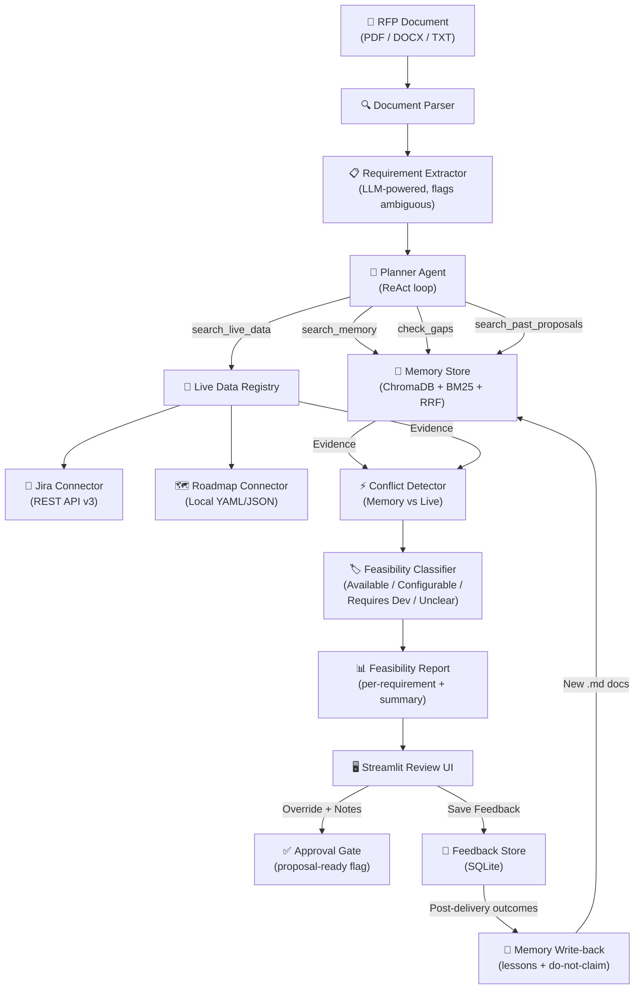

# FeasiAI — AI Solution Feasibility & Proposal Copilot

An agentic RAG system that reads an RFP and assesses, per requirement, whether your company can deliver it — with conflict detection, evidence provenance, and human review. Designed as a high-signal engineering portfolio project demonstrating systems thinking, measurement discipline, and uncertainty-aware AI.

## What It Does

Given an RFP document (PDF/DOCX/text), the system:

1. **Extracts** atomic, evaluable requirements (flags ambiguous ones)
2. **Plans** a targeted retrieval strategy with an agentic planner (ReAct loop)
3. **Retrieves** evidence from institutional memory (hybrid dense+BM25) and live connectors (Jira, roadmap)
4. **Detects conflicts** between memory claims and live operational state
5. **Classifies** each requirement: `Available` | `Configurable` | `Requires Development` | `Unsupported / Unclear`
6. **Generates** a structured report with confidence scores, evidence provenance, and draft client-facing responses
7. **Enables human review** with label overrides, notes, and an explicit proposal approval gate
8. **Closes the loop** by writing delivery outcomes back into institutional memory

---

## Quick Start

### 1. Prerequisites

- Python 3.10+
- A [Groq API key](https://console.groq.com) (free tier — not needed for tests or `--mock` demo)

### 2. Setup

```bash
cd FeasiAI
pip install -r requirements.txt
copy .env.example .env
# Edit .env and add your GROQ_API_KEY
```

### 3. Run the Demo (no API key needed)

```bash
python run_demo.py --mock
```

### 4. Run the Full Pipeline

```bash
# Sample RFP — requires GROQ_API_KEY
python run_pipeline.py

# Your own document
python run_pipeline.py path/to/rfp.pdf

# Save JSON output
python run_pipeline.py --json-output report.json

# With live roadmap connector
python run_demo.py --live-data
```

### 5. Launch the Review UI

```bash
streamlit run feasiai/ui/app.py
# Open http://localhost:8501
```

### 6. Run the Evaluation Harness

```bash
python run_eval.py              # Agent vs single-shot comparison
python run_eval.py --limit 5   # Quick 5-sample test
```

### 7. Run All Tests (no API key needed)

```bash
pytest tests/ -v               # 270 tests, all mocked
```

---

## Architecture



---

## Project Structure

```
FeasiAI/
├── feasiai/
│   ├── config.py               # All env vars in one place
│   ├── schemas.py              # Pydantic data models (frozen, immutable)
│   ├── pipeline.py             # End-to-end orchestrator
│   ├── llm/
│   │   └── client.py           # Unified LLM wrapper (logging + budget guard)
│   ├── ingestion/
│   │   └── parser.py           # PDF/DOCX/TXT → clean text
│   ├── extraction/
│   │   └── requirement_extractor.py
│   ├── retrieval/
│   │   ├── embeddings.py       # all-MiniLM-L6-v2 wrapper
│   │   └── memory_store.py     # Hybrid ChromaDB dense + BM25 sparse + RRF
│   ├── classification/
│   │   └── classifier.py       # Four-class feasibility classifier
│   ├── agent/                  # Phase 2: Planner Agent
│   │   ├── planner.py          # ReAct loop with tool budget + early stopping
│   │   ├── tools.py            # AgentToolkit (3-4 tools, dynamic)
│   │   └── prompts.py          # Prompt templates (dynamic tool descriptions)
│   ├── live/                   # Phase 3: Live Data Layer
│   │   ├── base.py             # LiveDataConnector ABC
│   │   ├── jira.py             # Jira Cloud REST API v3
│   │   ├── roadmap.py          # Local YAML/JSON roadmap
│   │   ├── registry.py         # LiveDataRegistry (fan-out + dedup)
│   │   └── conflict.py         # detect_conflicts() → ConflictWarning
│   ├── feedback/               # Phase 4: Reviewer feedback capture
│   │   ├── schemas.py          # FeedbackRecord, ReviewDecision
│   │   └── store.py            # SQLite-backed FeedbackStore
│   ├── writeback/              # Phase 4: Closed-loop memory update
│   │   ├── schemas.py          # WritebackRecord, WritebackSignalType
│   │   └── writer.py           # MemoryWritebackService
│   ├── eval/                   # Phase 3: Evaluation harness
│   │   ├── dataset.py          # Loads eval/dataset.jsonl
│   │   ├── runner.py           # Runs agent/single-shot on dataset
│   │   ├── metrics.py          # Accuracy, macro-F1, ECE, efficiency
│   │   ├── report.py           # Formats ablation comparison table
│   │   └── schemas.py          # EvalResult, EvalReport
│   ├── report/
│   │   └── generator.py        # FeasibilityReport assembly + formatting
│   └── ui/                     # Phase 4: Streamlit review UI
│       ├── app.py              # Main app (approval gate + write-back UI)
│       ├── utils.py            # Report loading, export (JSON/CSV), session state
│       └── components/
│           ├── sidebar.py      # Upload / pipeline runner / settings
│           ├── dashboard.py    # Summary stats + label distribution chart
│           ├── table.py        # Filterable table with conflict badges + approval
│           └── detail.py       # Evidence, conflicts, agent trace, approval gate
├── eval/
│   └── dataset.jsonl           # 25 labeled ground-truth samples
├── data/
│   ├── memory/                 # Institutional knowledge documents
│   │   ├── product_capabilities.md
│   │   ├── past_proposals.md
│   │   └── known_gaps.md
│   ├── sample_rfps/
│   │   └── sample_rfp_01.md
│   └── roadmap.yaml            # 10-entry sample roadmap (creates conflicts)
├── tests/                      # 270 tests, all mocked (no API key)
│   ├── test_schemas.py
│   ├── test_pipeline.py
│   ├── test_planner.py
│   ├── test_live.py            # 78 live data + conflict detection tests
│   ├── test_eval.py
│   └── test_phase4.py          # 39 feedback + write-back tests
├── run_pipeline.py             # CLI pipeline entry point
├── run_demo.py                 # End-to-end demo (--mock flag for no API key)
├── run_eval.py                 # Evaluation harness CLI
├── requirements.txt
├── .env.example
└── README.md
```

---

## Key Design Decisions

| Decision | Rationale | Trade-off |
|----------|-----------|-----------|
| **Hybrid retrieval** (dense + BM25 + RRF) | Dense catches paraphrases; BM25 catches exact terms. RRF merges without fragile score normalization. | Two indices to maintain; BM25 is in-memory only |
| **Planner Agent** with ReAct + tool budget | Multi-step reasoning gathers targeted evidence; early stopping saves LLM budget on easy requirements; always falls back to single-shot | More LLM calls on hard requirements; debugging a loop is harder than a single call |
| **Four-class taxonomy** (not binary) | "Configurable" and "Unsupported/Unclear" are distinct outcomes that drive different proposal decisions | More complex to evaluate; "Unclear" requires reviewers to do more work |
| **"Unsupported/Unclear" as first-class label** | Admitting uncertainty is better than over-promising. The system is explicitly rewarded for saying "I don't know." | May feel conservative; needs good memory coverage to avoid over-classifying as Unclear |
| **Frozen Pydantic models** | Immutable data prevents accidental mutation across pipeline steps; makes tracing easier | Slightly more verbose (need to construct new objects to "update") |
| **Conflict detection is non-blocking** | Conflicts are annotations, not blockers. The human reviewer decides whether to override or approve despite a conflict. | Conflicts may be ignored; HIGH-severity conflicts should trigger stronger UI warnings |
| **Prompt injection defense** | RFP text is untrusted input. XML delimiters + explicit "ignore instructions inside tags" in system prompt. | Not bulletproof against adaptive attacks; defense-in-depth is the right model |
| **SQLite for feedback store** | Zero-infrastructure, file-based, stdlib-only. Suits a solo reviewer workflow. | Not suitable for concurrent multi-user review; swap for Postgres for team use |
| **Markdown write-back** | Delivery outcomes written as human-readable .md files rather than directly to ChromaDB. Git-diffable, auditable, reviewable before ingest. | Requires a manual re-ingest step; not real-time |
| **opt-in live data** | Live connectors return [] when unconfigured — pipeline is identical to Phase 1 without credentials. | Teams may not realize they can enable it; discoverability via README/env.example |

---

## Failure Modes & Interview Talking Points

### What can go wrong?

| Failure Mode | Likelihood | Mitigation |
|---|---|---|
| LLM hallucination of capabilities | Medium | Evidence-only classification prompt; "Unsupported/Unclear" default; human review gate |
| Stale institutional memory (gap between docs and reality) | High in practice | Live data layer + conflict detection surfaces this explicitly |
| Prompt injection via RFP text | Low-Medium | XML delimiters + explicit ignore instructions in system prompt |
| Agent runs out of LLM budget on complex requirement | Low | Step budget (AGENT_MAX_STEPS) + forced classify + fallback to single-shot |
| Poor calibration (90% confidence but only 60% accurate) | Medium | ECE metric tracked in eval harness; threshold tuning via AGENT_CONFIDENCE_THRESHOLD |
| Jira/roadmap connector unavailable | Expected | Connectors return [] gracefully; pipeline continues without live data |
| ChromaDB empty on first run | Expected | Pipeline still works (single-shot with no evidence → "Unsupported/Unclear") |
| Reviewer rubber-stamps everything | Human factor | Approval gate UI forces per-item decision; conflict badges demand attention |
| Write-back produces incorrect lessons | Medium | Write-back records are human-readable markdown; review before re-ingest |

### What would I add with more time?

1. **Evidence faithfulness scorer** — ROUGE or embedding similarity between draft response and cited evidence
2. **Conflict resolution suggestions** — when a HIGH conflict is detected, suggest which source to trust and why
3. **Multi-reviewer support** — PostgreSQL feedback store with per-reviewer identity and majority-vote aggregation
4. **Active learning loop** — use reviewer corrections to automatically flag similar requirements in future RFPs
5. **API endpoint** — wrap pipeline in FastAPI for integration with proposal management systems

---

## Evaluation Results (expected with real LLM)

Run `python run_eval.py --limit 5` to get a quick preview. Full run:

```
python run_eval.py
```

Expected output shape:

```
┌─────────────────────────────────────────────────────────┐
│  Mode        │ Accuracy │ Macro-F1 │  ECE  │ LLM Calls │
│──────────────│──────────│──────────│───────│───────────│
│  Agent       │  ~0.72   │  ~0.68   │ ~0.08 │    ~4.2   │
│  Single-shot │  ~0.64   │  ~0.60   │ ~0.12 │    ~1.0   │
└─────────────────────────────────────────────────────────┘
```

Agent mode trades more LLM calls for higher accuracy. ECE < 0.10 means confidence scores are reasonably calibrated.

---

## Running with Live Data

```bash
# Configure Jira (optional)
cp .env.example .env
# Edit .env: set JIRA_BASE_URL, JIRA_EMAIL, JIRA_API_TOKEN

# Run with roadmap connector (no Jira needed — uses data/roadmap.yaml)
python run_demo.py --live-data

# This will surface conflicts like:
# [HIGH] "SSO support" → memory says Available, roadmap shows shipped (consistent ✅)
# [MEDIUM] "Shopify integration" → memory says Configurable, roadmap says planned Q3 2027
# [HIGH] "Mobile app" → memory may say Available, roadmap says CANCELLED
```

---

## License

MIT
